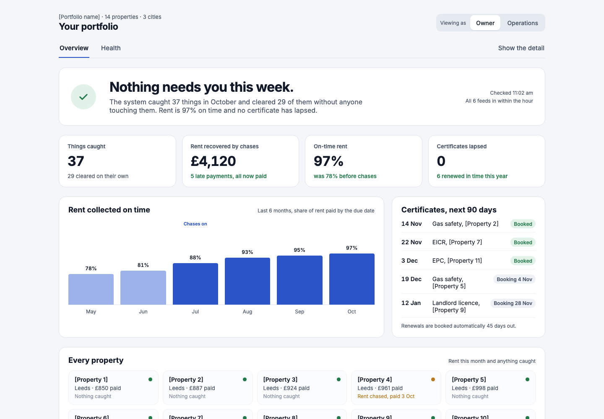
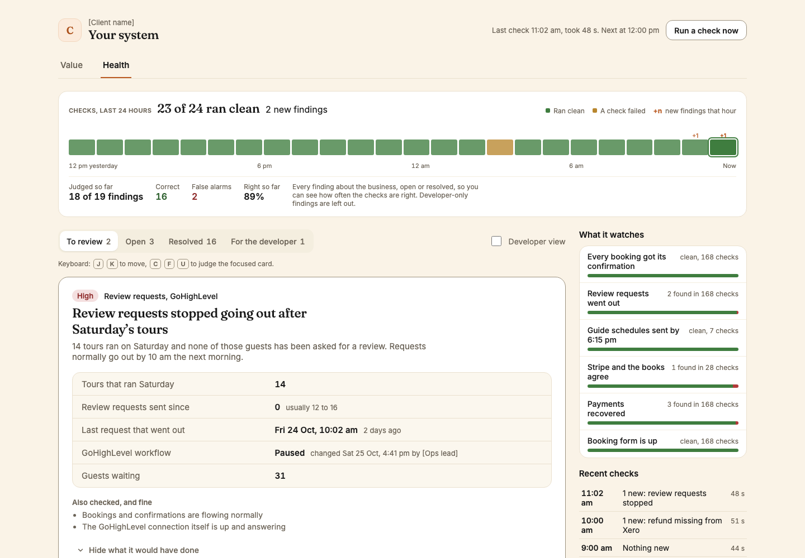

# Watchdog Kit

**Agent Skills that put telemetry and a watchdog on a client app, and stop for a human at every decision that matters.**

Two skills, run in this order:

| Skill | What you get | When |
|---|---|---|
| `/telemetry` | PostHog installed properly, and a page the client opens to see the build working | Start of client testing |
| `/watchdog-build` | A report-only watchdog that catches silent failures, scored against the app's own past incidents | Once the build is stable |

Works in Claude Code (`/name`) and Codex (`$name`).

| The value tab, as the owner sees it | The Health tab, with the watchdog's findings |
|---|---|
|  |  |

<sub>Design boards with placeholder data.</sub>

## Quick start

```
git clone https://github.com/Ayy-man/watchdog-kit ~/watchdog-kit
cd ~/watchdog-kit
node scripts/install.mjs --all --yes
```

Then open a client repo and run `/telemetry`. It asks three questions, scans the code, and tells you what it needs next. Run it again any time and it picks up where it stopped.

## /telemetry

1. **Asks** the tier, who signs off, and whose client it is.
2. **Scans** the code and writes `.telemetry/SERVICES.md`: every service the app touches and how its events will reach PostHog.
3. **Installs PostHog** in the account you name (yours, the client's or a partner's, new or existing project, US or EU): tags on every event, internal users filtered out, AI prompts kept private, a reverse proxy, replay masking.
4. **Plans the page** in ten steps, writes `.telemetry/PAGE-PLAN.md`, and **stops** for the account owner.
5. **Builds the page** in the client's own stack and design system.
6. **Hands on** to `/watchdog-build` on Custodian builds. The watchdog's findings page becomes the Health tab.

It never passes these without the account owner: which PostHog account and region, the billing limits, session replay consent, and the page plan. It writes only `.telemetry/`. Four worked plans in `skills/telemetry/references/examples/` show the same steps producing very different pages.

## /watchdog-build

1. **Surveys** every door the app has (webhooks in, provider calls out, scheduled jobs) and how each proves it fired.
2. **Builds deterministic checks** on that contract, plus a model review that may only quote evidence it was handed.
3. **Puts findings on a page** where a human marks each one correct or a false alarm.
4. **Scores itself** against the app's own incident history.

Nine phases, a human stop after each. Report-only by construction: the runtime holds no credential it could send with. The phase order and gates are in `skills/watchdog-build/SKILL.md` and `skills/watchdog-build/references/shared-contract.md`.

<details>
<summary><b>Two ways to work</b> (step by step, or run ahead)</summary>

On the first run it asks which way you want to work. The answer changes when it asks, never who decides.

- **Step by step** (default): it stops and asks at every checkpoint. For when you are at the keyboard.
- **Run ahead**: you answer up front what can be answered up front (the model key's variable name, the spend cap, the review slot times, which model to keep after the bake-off), and it builds everything whose inputs exist while queueing the questions that need you. `--status` lists the queue when you come back. Independent phases (the explainer, the incident history, the heartbeats) run at the same time once the survey is approved.

Three things wait for a human in both modes: approving the survey before anything reads production or spends, judging the findings, and the merge. Expect about five touchpoints in run-ahead mode instead of nine.

</details>

<details>
<summary><b>Supported stacks</b></summary>

The watchdog assumes a Node or TypeScript app, data in Postgres (queried through a PostgREST-style builder, either a hosted data API or a thin adapter over a direct connection), jobs on a cron-style scheduler (host cron, a task runner, pg_cron, a CI schedule), and Fetch-style route handlers. The survey checks each assumption and records anything outside them as unsupported, with what it would take to cover, rather than building on a guess.

`/telemetry` covers Next.js, Vite single-page apps, Capacitor and Expo mobile apps, and Supabase or other Deno edge functions; see `skills/telemetry/references/install.md`.

</details>

<details>
<summary><b>Install options</b></summary>

`node scripts/install.mjs --all` without `--yes` is a dry run that lists what it would create. The default install symlinks, so moving or deleting the checkout breaks it; add `--copy` for a copy that stands alone, and `--uninstall --yes` removes exactly what an earlier run created.

Re-running a `--copy` install refreshes files you have not touched and keeps, with a report, any file you edited. `node scripts/install.mjs --check` changes nothing and exits 1 on any problem with an earlier install, one line per problem with its fix.

As a Claude Code plugin: `/plugin marketplace add Ayy-man/watchdog-kit`, then `/plugin install watchdog-kit@watchdog-kit-local`, and run skills as `/watchdog-kit:telemetry` and `/watchdog-kit:watchdog-build`.

</details>

<details>
<summary><b>Layout</b></summary>

```
core/            the generic runtime, vendored into each client as lib/watchdog/core/ with a version stamp
  contracts/     the interfaces every client adapter and check must satisfy (start here)
skills/          Agent Skills standard: SKILL.md + references/ + scripts/; read unchanged by Claude Code and Codex
templates/       the files a run writes into .watchdog/ in the client repo
agents/          Claude subagent definitions; codex/agents/ holds the TOML equivalents
scripts/         install and vendoring helpers
```

</details>

<details>
<summary><b>Vocabulary</b></summary>

These words mean one thing each, everywhere in this repo and in every prompt it generates.

- **door**: a boundary event of the client app. Inbound (a webhook, inbound mail), outbound (a provider call), or internal (a cron).
- **proof**: the signal that a door fired. A row, a receipt, a provider id, a heartbeat.
- **proof-of-proof**: the test that the proof is trustworthy. Reconcile identities against the provider, not counts.
- **obligation**: what an event owes, to whom, by when, with what exceptions. Written independently of the sender's code.
- **end state**: what should be true between two doors. The model's territory; code owns the doors.
- **adjudicated on live**: every finding from a dry run against production is judged by a human. Real faults stay open with an owner. Only a confirmed false alarm changes a check.
- **report-only**: the watchdog reads app data through a SELECT-only role; writes only the watchdog's own tables through a separate writer. A forbidden write is a test that must fail, and nothing it deploys can send.
- **finding 0**: a door with no proof. It blocks any claim of coverage.
- **sweep**: one run of the watchdog over its scopes, every rule check first and then the model checks, recorded as a `watchdog_sweeps` row. It is scheduled every 30 minutes; a hand-started one is logged as `watchdog.sweep.manual`.
- **generation**: the number a sweep claims when it starts. Every finding write is fenced on it, so an older sweep never overwrites a newer one's rows, and a run on another generation resolves nothing.
- **receipt**: what a sweep records about its own reading: sources, rows, truncation, per-check coverage and timing, reads and spend.
- **packet**: the bounded, pseudonymised bundle of one subject's rows and messages that a model check reads, with every due time already computed in code.
- **review slot**: a local time of day at which model checks may spend. A subject is reviewed once per slot, or at once when a rule check has just flagged it.
- **bake-off**: the counted comparison of shortlisted models on planted, held-out real and healthy packets, with every case in the tally.
- **heartbeat**: the record that a scheduled job ran, a `job_runs` row opened at start and closed at the end, or an existing record that already proves it.
- **wrapper**: `runCronJob`, which writes a job's heartbeat around its handler and never changes the handler's response or error.
- **hub**: an optional central view across installations. It pulls each installation's summary projection; the watchdog never posts to it.
- **report-and-tell**: the second contract level, the same code plus a separately provisioned alert sender, added in its own authorised change after the alert gates pass.

</details>

## Status

27 Oct 2026: `/telemetry` added, covering the PostHog install and the client page. Core 0.2.6. `node evals/run-all.mjs` runs 13 eval files, all green.
