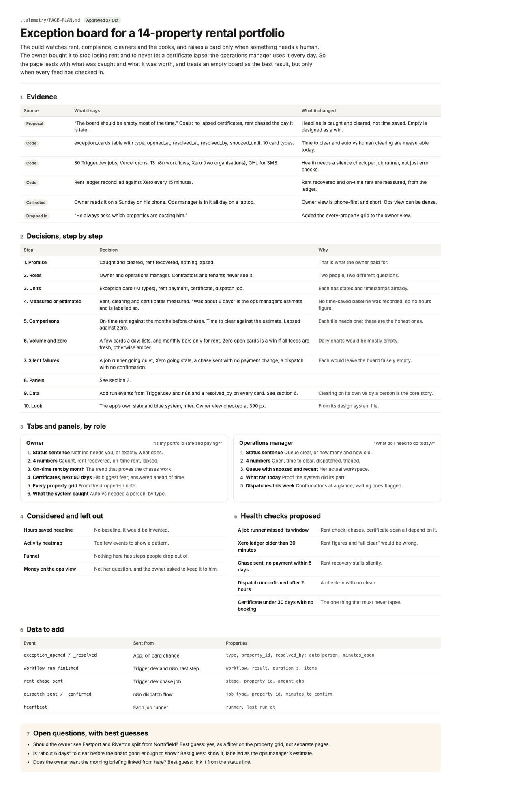
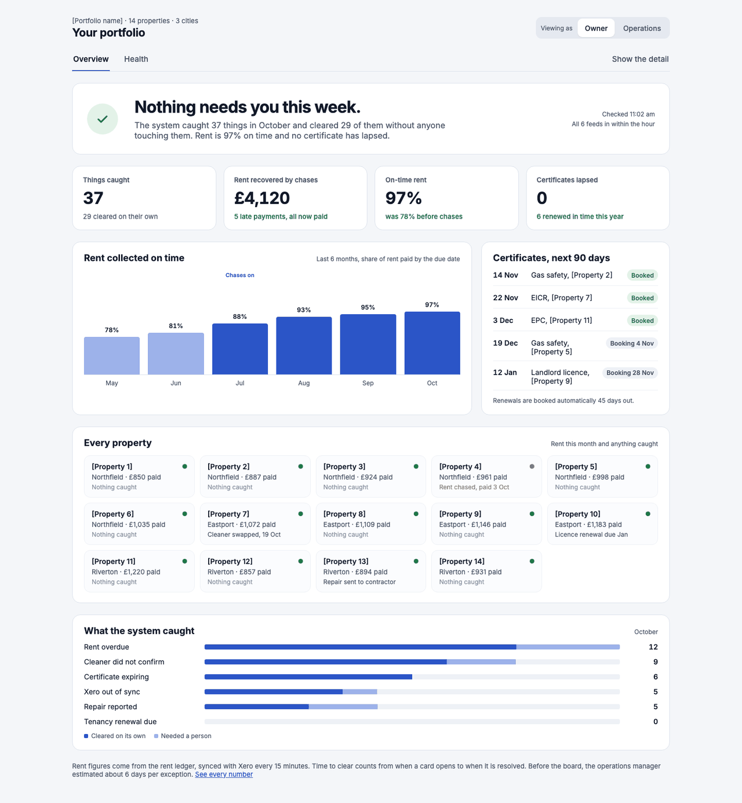
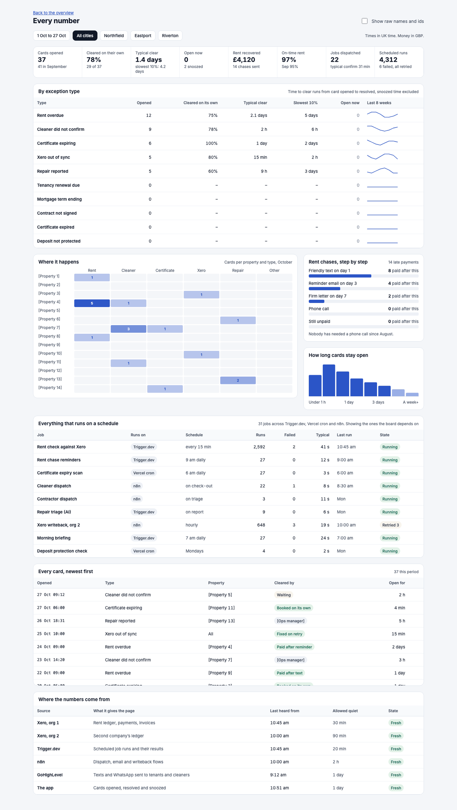
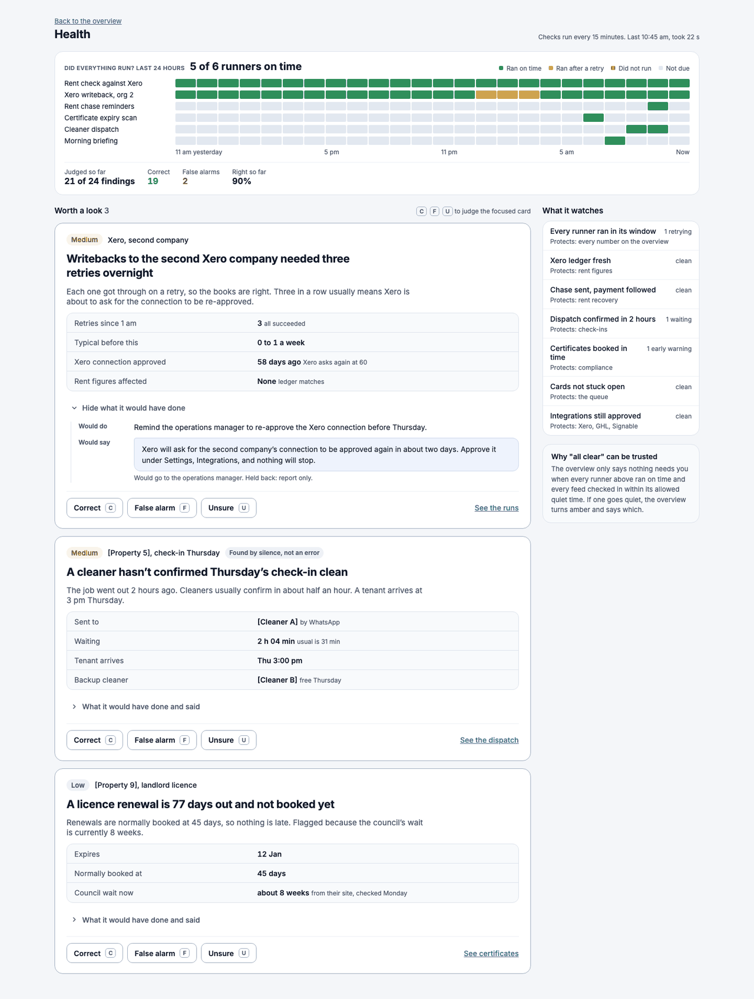

# Worked plan: Exception board for a 14-property rental portfolio

Status: approved 27 oct (worked example; names are placeholders and figures are samples)

The build watches rent, compliance, cleaners and the books, and raises a card only when something needs a human. The owner bought it to stop losing rent and to never let a certificate lapse; the operations manager uses it every day. So the page leads with what was caught and what it was worth, and treats an empty board as the best result, but only when every feed has checked in.

## 1. Evidence

| Source | What it says | What it changed |
|---|---|---|
| Proposal | “The board should be empty most of the time.” Goals: no lapsed certificates, rent chased the day it is late. | Headline is caught and cleared, not time saved. Empty is designed as a win. |
| Code | exception_cards table with type, opened_at, resolved_at, resolved_by, snoozed_until. 10 card types. | Time to clear and auto vs human clearing are measurable today. |
| Code | 30 Trigger.dev jobs, Vercel crons, 13 n8n workflows, Xero (two organisations), GHL for SMS. | Health needs a silence check per job runner, not just error checks. |
| Code | Rent ledger reconciled against Xero every 15 minutes. | Rent recovered and on-time rent are measured, from the ledger. |
| Call notes | Owner reads it on a Sunday on his phone. Ops manager is in it all day on a laptop. | Owner view is phone-first and short. Ops view can be dense. |
| Dropped in | “He always asks which properties are costing him.” | Added the every-property grid to the owner view. |

## 2. Decisions, step by step

| Step | Decision | Why |
|---|---|---|
| 1. Promise | Caught and cleared, rent recovered, nothing lapsed. | That is what the owner paid for. |
| 2. Roles | Owner and operations manager. Contractors and tenants never see it. | Two people, two different questions. |
| 3. Units | Exception card (10 types), rent payment, certificate, dispatch job. | Each has states and timestamps already. |
| 4. Measured or estimated | Rent, clearing and certificates measured. “Was about 6 days” is the ops manager’s estimate and is labelled so. | No time-saved baseline was recorded, so no hours figure. |
| 5. Comparisons | On-time rent against the months before chases. Time to clear against the estimate. Lapsed against zero. | Each tile needs one; these are the honest ones. |
| 6. Volume and zero | A few cards a day: lists, and monthly bars only for rent. Zero open cards is a win if all feeds are fresh, otherwise amber. | Daily charts would be mostly empty. |
| 7. Silent failures | A job runner going quiet, Xero going stale, a chase sent with no payment change, a dispatch with no confirmation. | Each would leave the board falsely empty. |
| 8. Panels | See section 4. |  |
| 9. Data | Add run events from Trigger.dev and n8n and a resolved_by on every card. See section 7. | Clearing on its own vs by a person is the core story. |
| 10. Look | The app’s own slate and blue system, Inter. Owner view checked at 390 px. | From its design system file. |

## 3. Role matrix

| Panel | Owner | Operations manager |
|---|---|---|
| Rent recovered, on-time rent | Full | No |
| Things caught, by type | Full | Full |
| Certificates, next 90 days | Full | Full |
| Every property grid | Full | No |
| Queue, snoozed, recently cleared | No | Full |
| Dispatches and what ran today | No | Full |
| Detail layer | Full | Full |
| Health | Full | Full |

## 4. Tabs and panels, by role

### Owner: “Is my portfolio safe and paying?”

1. **Status sentence**: Nothing needs you, or exactly what does.
2. **4 numbers**: Caught, rent recovered, on-time rent, lapsed.
3. **On-time rent by month**: The trend that proves the chases work.
4. **Certificates, next 90 days**: His biggest fear, answered ahead of time.
5. **Every property grid**: From the dropped-in note.
6. **What the system caught**: Auto vs needed a person, by type.

### Operations manager: “What do I need to do today?”

1. **Status sentence**: Queue clear, or how many and how old.
2. **4 numbers**: Open, time to clear, dispatched, triaged.
3. **Queue with snoozed and recent**: Her actual workspace.
4. **What ran today**: Proof the system did its part.
5. **Dispatches this week**: Confirmations at a glance, waiting ones flagged.

## 5. Considered and left out

| Panel | Why not |
|---|---|
| Hours saved headline | No baseline. It would be invented. |
| Activity heatmap | Too few events to show a pattern. |
| Funnel | Nothing here has steps people drop out of. |
| Money on the ops view | Not her question, and the owner asked to keep it to him. |

## 6. Health checks

| Check | Protects |
|---|---|
| A job runner missed its window | Rent check, chases, certificate scan all depend on it. |
| Xero ledger older than 30 minutes | Rent figures and “all clear” would be wrong. |
| Chase sent, no payment within 5 days | Rent recovery stalls silently. |
| Dispatch unconfirmed after 2 hours | A check-in with no clean. |
| Certificate under 30 days with no booking | The one thing that must never lapse. |

## 7. Data to add

| Event | Sent from | Properties |
|---|---|---|
| `exception_opened / _resolved` | App, on card change | type, property_id, resolved_by: auto\|person, minutes_open |
| `workflow_run_finished` | Trigger.dev and n8n, last step | workflow, result, duration_s, items |
| `rent_chase_sent` | Trigger.dev chase job | stage, property_id, amount_gbp |
| `dispatch_sent / _confirmed` | n8n dispatch flow | job_type, property_id, minutes_to_confirm |
| `heartbeat` | Each job runner | runner, last_run_at |

## 8. Open questions

1. Should the owner see Grimsby and Hull split from Leeds? Best guess: yes, as a filter on the property grid, not separate pages.
2. Is “about 6 days” to clear before the board good enough to show? Best guess: show it, labelled as the ops manager’s estimate.
3. Does the owner want the morning briefing linked from here? Best guess: link it from the status line.

## What it looks like

Design boards with placeholder data, from the reference canvas. They show the bar, not a template: build in the client's own design system.

**The approved page plan**

**Value tab with the Owner and Operations switch**

**Every number: exception types, where they happen, scheduled jobs, every card, where the numbers come from**

**Health tab: heartbeat grid and silence cards**

