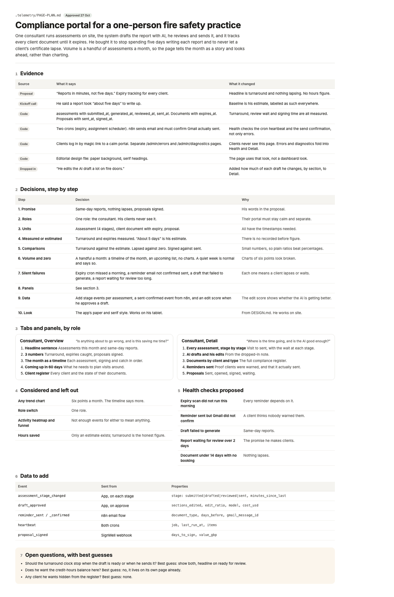
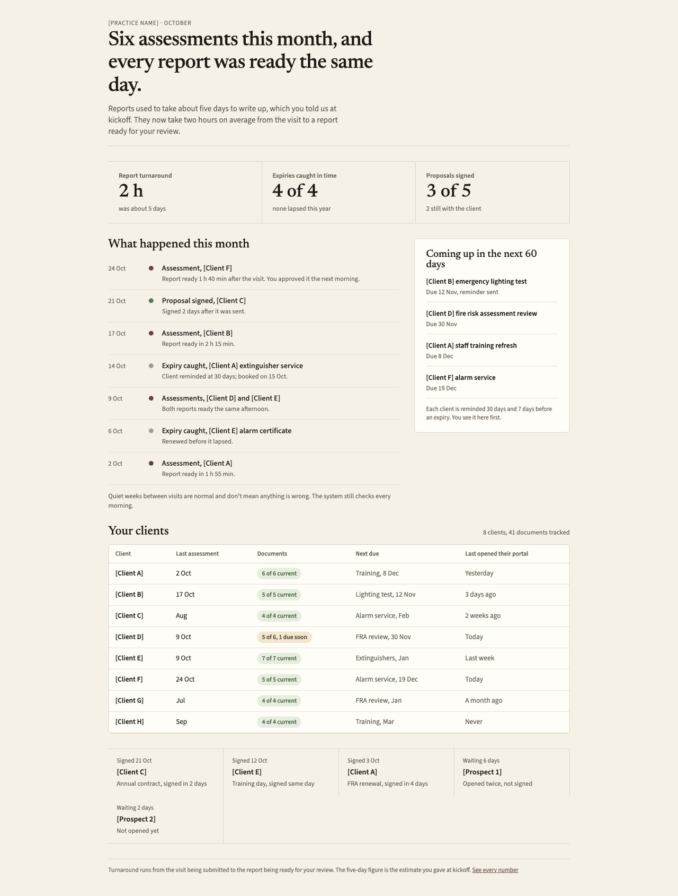
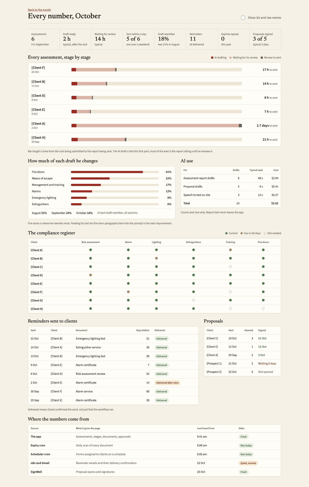
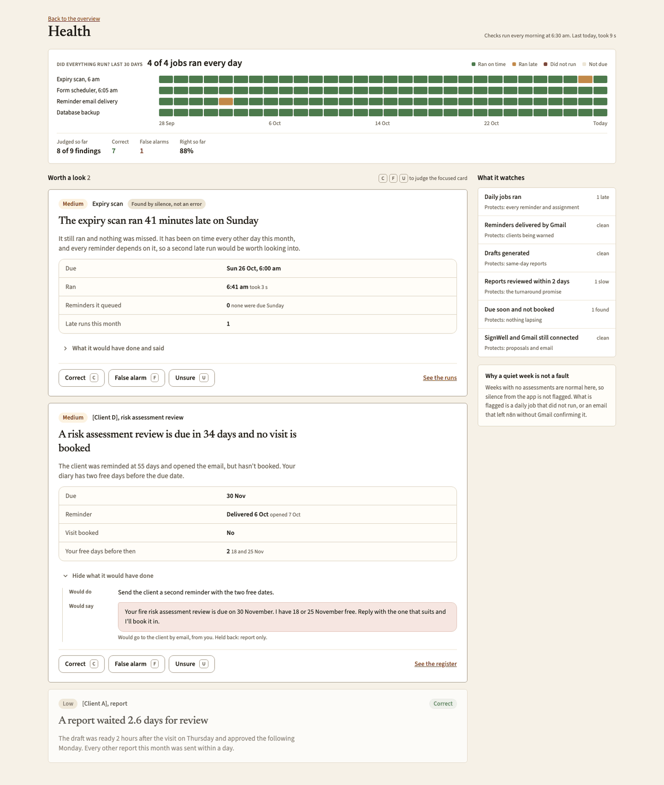

# Worked plan: Compliance portal for a one-person fire safety practice

Status: approved 27 oct (worked example; names are placeholders and figures are samples)

One consultant runs assessments on site, the system drafts the report with AI, he reviews and sends it, and it tracks every client document until it expires. He bought it to stop spending five days writing each report and to never let a client’s certificate lapse. Volume is a handful of assessments a month, so the page tells the month as a story and looks ahead, rather than charting.

## 1. Evidence

| Source | What it says | What it changed |
|---|---|---|
| Proposal | “Reports in minutes, not five days.” Expiry tracking for every client. | Headline is turnaround and nothing lapsing. No hours figure. |
| Kickoff call | He said a report took “about five days” to write up. | Baseline is his estimate, labelled as such everywhere. |
| Code | assessments with submitted_at, generated_at, reviewed_at, sent_at. Documents with expires_at. Proposals with sent_at, signed_at. | Turnaround, review wait and signing time are all measured. |
| Code | Two crons (expiry, assignment scheduler). n8n sends email and must confirm Gmail actually sent. | Health checks the cron heartbeat and the send confirmation, not only errors. |
| Code | Clients log in by magic link to a calm portal. Separate /admin/errors and /admin/diagnostics pages. | Clients never see this page. Errors and diagnostics fold into Health and Detail. |
| Code | Editorial design file: paper background, serif headings. | The page uses that look, not a dashboard look. |
| Dropped in | “He edits the AI draft a lot on fire doors.” | Added how much of each draft he changes, by section, to Detail. |

## 2. Decisions, step by step

| Step | Decision | Why |
|---|---|---|
| 1. Promise | Same-day reports, nothing lapses, proposals signed. | His words in the proposal. |
| 2. Roles | One role: the consultant. His clients never see it. | Their portal must stay calm and separate. |
| 3. Units | Assessment (4 stages), client document with expiry, proposal. | All have the timestamps needed. |
| 4. Measured or estimated | Turnaround and expiries measured. “About 5 days” is his estimate. | There is no recorded before figure. |
| 5. Comparisons | Turnaround against the estimate. Lapsed against zero. Signed against sent. | Small numbers, so plain ratios beat percentages. |
| 6. Volume and zero | A handful a month: a timeline of the month, an upcoming list, no charts. A quiet week is normal and says so. | Charts of six points look broken. |
| 7. Silent failures | Expiry cron missed a morning, a reminder email not confirmed sent, a draft that failed to generate, a report waiting for review too long. | Each one means a client lapses or waits. |
| 8. Panels | See section 4. |  |
| 9. Data | Add stage events per assessment, a sent-confirmed event from n8n, and an edit score when he approves a draft. | The edit score shows whether the AI is getting better. |
| 10. Look | The app’s paper and serif style. Works on his tablet. | From DESIGN.md. He works on site. |

## 3. Role matrix

One role, the consultant, who sees everything. His clients use a separate portal and never receive any of this page's data.

## 4. Tabs and panels, by role

### Consultant, Overview: “Is anything about to go wrong, and is this saving me time?”

1. **Headline sentence**: Assessments this month and same-day reports.
2. **3 numbers**: Turnaround, expiries caught, proposals signed.
3. **The month as a timeline**: Each assessment, signing and catch in order.
4. **Coming up in 60 days**: What he needs to plan visits around.
5. **Client register**: Every client and the state of their documents.

### Consultant, Detail: “Where is the time going, and is the AI good enough?”

1. **Every assessment, stage by stage**: Visit to sent, with the wait at each stage.
2. **AI drafts and his edits**: From the dropped-in note.
3. **Documents by client and type**: The full compliance register.
4. **Reminders sent**: Proof clients were warned, and that it actually sent.
5. **Proposals**: Sent, opened, signed, waiting.

## 5. Considered and left out

| Panel | Why not |
|---|---|
| Any trend chart | Six points a month. The timeline says more. |
| Role switch | One role. |
| Activity heatmap and funnel | Not enough events for either to mean anything. |
| Hours saved | Only an estimate exists; turnaround is the honest figure. |

## 6. Health checks

| Check | Protects |
|---|---|
| Expiry scan did not run this morning | Every reminder depends on it. |
| Reminder sent but Gmail did not confirm | A client thinks nobody warned them. |
| Draft failed to generate | Same-day reports. |
| Report waiting for review over 2 days | The promise he makes clients. |
| Document under 14 days with no booking | Nothing lapses. |

## 7. Data to add

| Event | Sent from | Properties |
|---|---|---|
| `assessment_stage_changed` | App, on each stage | stage: submitted\|drafted\|reviewed\|sent, minutes_since_last |
| `draft_approved` | App, on approve | sections_edited, edit_ratio, model, cost_usd |
| `reminder_sent / _confirmed` | n8n email flow | document_type, days_before, gmail_message_id |
| `heartbeat` | Both crons | job, last_run_at, items |
| `proposal_signed` | SignWell webhook | days_to_sign, value_gbp |

## 8. Open questions

1. Should the turnaround clock stop when the draft is ready or when he sends it? Best guess: show both, headline on ready for review.
2. Does he want the credit-hours balance here? Best guess: no, it lives on its own page already.
3. Any client he wants hidden from the register? Best guess: none.

## What it looks like

Design boards with placeholder data, from the reference canvas. They show the bar, not a template: build in the client's own design system.

**The approved page plan**

**Value tab: a timeline, the register and proposals, for a few jobs a month**

**Detail layer**

**Health tab**

