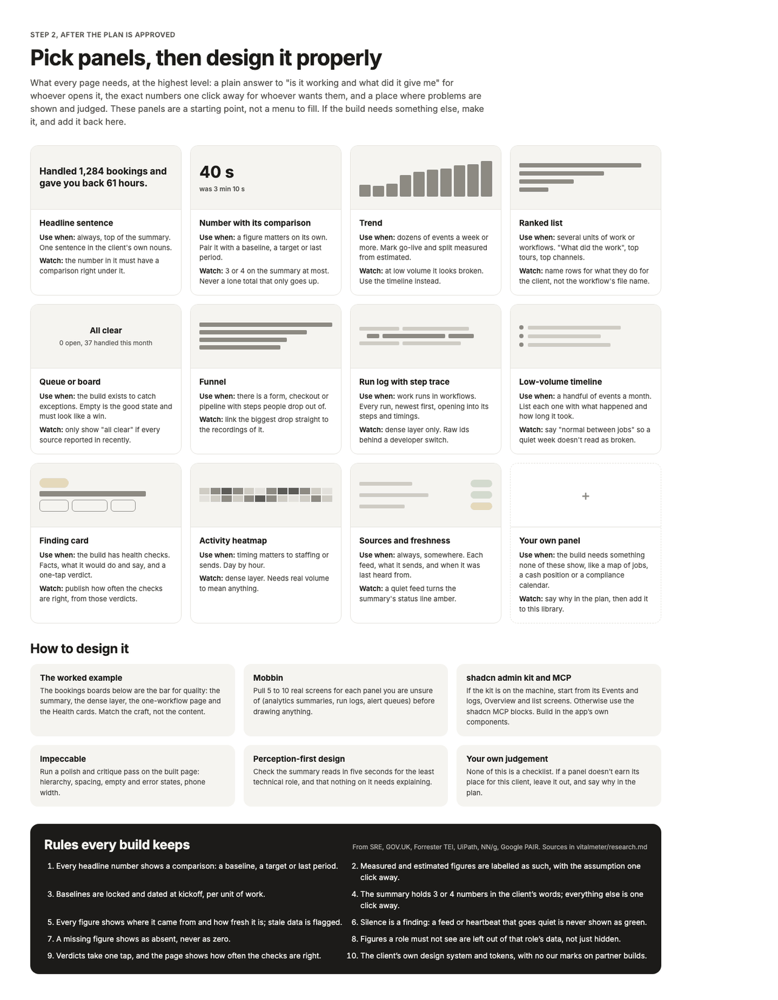

# Panel library

What every page needs, at the highest level: a plain answer to "is it working and what did it give me" for whoever opens it, the exact numbers one deliberate click away for whoever wants them, and a place where problems are shown and judged. These panels are a starting point, not a menu to fill. Pick the ones the plan gives a job to, leave the rest out with a reason, and when a build needs something not listed here, make it and add it to this file.

Each entry says what the panel is for, when to use it, and the mistake to avoid.

## Summary layer

**Headline sentence.** One sentence at the top in the client's own nouns: "Handled 1,284 bookings and gave you back about 61 hours", "Nothing needs you this week", "Six assessments, every report ready the same day". Use it on every summary. The number in it must have its comparison directly underneath.

**Status line.** A single verdict over the last period, with the time it was checked: everything ran on time, or how many things need a look. Use it on every summary. It turns amber when any source the page depends on is past its allowed quiet time, so "all clear" can be trusted.

**Number with its comparison.** One figure, its comparison (baseline, target, last period or peer median) and, where it is an estimate, a label saying so. Three or four on a summary at most. Never a lone total that only goes up.

**Measured and estimated split.** A bar or a line under a savings figure showing how much is measured from runs and how much is credited from the baseline. Use it whenever a headline mixes the two.

**Trend.** Bars or a line over weeks or months, with go-live marked. Use it from dozens of events a week upward. At low volume it looks broken; use the timeline instead.

**Ranked list.** The units of work or workflows that did the most, each named for what it does for the client ("Guests asked for a review the morning after"), not by its file name. Use it whenever there is more than one workflow or unit type.

**Queue or board.** The open items a person must act on, with snoozed and recently cleared items underneath. Use it when the build exists to catch exceptions. Empty is the good state and must look like a win, but only when every feed is fresh.

**Low-volume timeline.** The period as a dated list: each event, what happened and how long it took. Use it when a handful of events happen a month, and say plainly that a quiet week is normal.

**Coming up.** Dated items in the next 30 to 90 days: expiries, renewals, scheduled work, with whether each is already handled. Use it when the build protects against something lapsing.

**Every subject grid.** A small card per property, client, location or tenant with its state for the period. Use it when the owner thinks in terms of their assets ("which properties are costing me").

**Peer comparison.** The viewer's figure against an anonymous median of peers. Use it on multi-tenant builds for tenant roles. Never name another tenant.

## Detail layer

**Totals strip.** Eight or so compact figures across the top of the detail page, each with a small sub-line. Use it at the top of every detail page.

**Per-unit table.** One row per workflow or unit type: count, success rate, typical and slowest durations, minutes saved each, hours, a small trend line and the last run. The core of most detail pages. Rows link to their own page.

**Breakdown matrix.** Counts by two dimensions, such as property by exception type or client by document type, shaded by count. Use it when the question is "where does this happen".

**Distribution.** A histogram of durations or time to clear. Use it when "typical" hides a long tail that matters.

**Step-by-step ladder or funnel.** Counts at each step of a form, pipeline or escalation (reminder, second reminder, letter, call). Use it when people or items drop out at steps. Link the largest drop to the session recordings of it.

**Stage bars.** One bar per item split by the time spent in each stage (drafting, waiting for review, sending). Use it when the question is where the time goes, and the answer is often a human wait, not the automation.

**Activity heatmap.** Day of week by hour. Use it only with real volume and when timing matters to staffing or sends.

**Run log with step trace.** Every run, newest first, filterable, each opening into its steps, their durations, retries and links to the source system. Use it whenever work runs in workflows. Raw ids sit behind a developer switch.

**AI usage.** Per purpose: model, calls, typical wait, tokens and cost, and where the build tracks it, how much of each AI draft a person rewrote. Counts and cost only; prompts and outputs are never stored.

**People.** Who uses the app, how often and for what, with anyone gone quiet flagged. Use it when adoption is part of the promise.

**Sources and freshness.** Each feed, what it gives the page, when it was last heard from, how long it is allowed to be quiet, and its state. Use it on every detail page.

## Health

**Heartbeat grid.** One row per scheduled job or feed, one cell per expected run (hours for frequent jobs, days for daily ones), coloured ran, ran late or after a retry, did not run, or not due. Use it on every build with scheduled work.

**Finding card.** The Watchdog card: severity, a context line naming the subject, plain fact rows, what was also checked and fine, a folded "what it would do and say", a one-tap Correct, False alarm or Unsure with a reason box on false alarms, and a label when a problem has come back. Mark findings caught by silence rather than an error. On a Custodian build this is the Watchdog page itself.

**Check list with precision.** Each check, what it protects, and how often it has been right from the verdicts given. Use it alongside finding cards.

**Switched-off state.** On a build without a Watchdog, the Health tab explains in plain words what health checks would watch for, and offers them. It is the upsell, so it is calm and specific, never alarming.

## Your own panel

If the build needs something none of these show, make it. Write in the plan why the library did not cover it, and add it here afterwards with its use and its mistake, so the next build has it.

## What the panels look like

Design boards with placeholder data, from the reference canvas. They show the bar, not a template: build in the client's own design system.

**The panel library, tools and rules**

