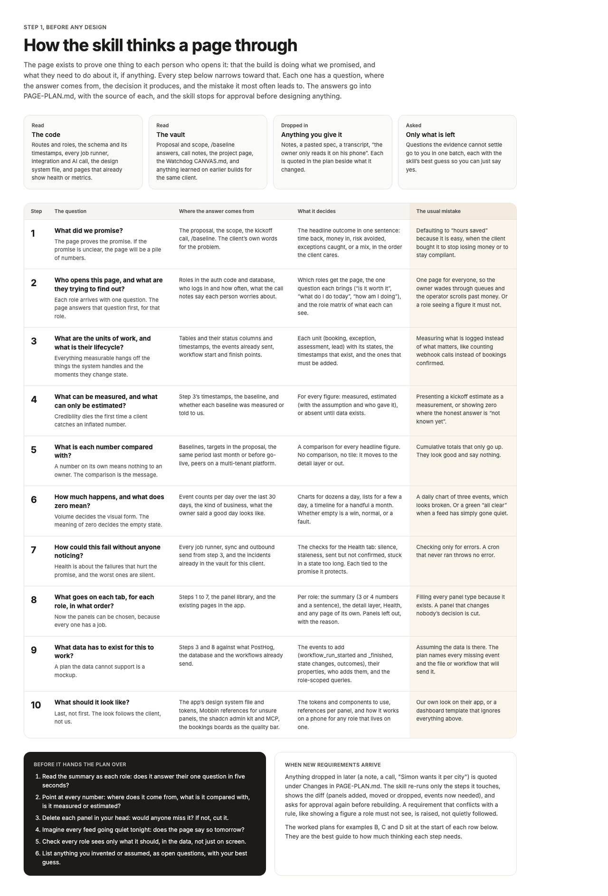

# How to think a page through

The page exists to prove one thing to each person who opens it: that the build is doing what we promised, and what they need to do about it, if anything. The ten steps below narrow toward that, in order. Each has a question, where the answer comes from, what it decides, and the mistake it most often leads to. Write each answer into PAGE-PLAN.md with its source. The four plans in `examples/` show the steps worked on real builds; when a step feels thin, look at how they handled it.

## 1. What did we promise?

The page proves the promise, so if the promise is vague the page will be a pile of numbers. Read the proposal, the scope, the kickoff call and the `/baseline` answers, and find the client's own words for the problem they paid to have solved. Decide the headline outcome in one sentence: time back, money in, risk avoided, exceptions caught, bookings made, or a mix in the order the client cares about.

The usual mistake is defaulting to "hours saved" because it is easy to compute. An owner who bought the build to stop losing rent, or to stay compliant, does not care about hours, and a page that leads with them tells him we did not listen.

## 2. Who opens this page, and what are they trying to find out?

Each role arrives with one question, and the page answers that question first, for that role. Read the roles in the auth code and the database, who logs in and how often, and what the call notes say each person worries about. Decide which roles get the page at all, the one question each brings ("is it worth it", "what do I do today", "how am I doing", "what have I earned"), and the role matrix: for every panel, whether each role sees all of it, only its own slice, counts without money, or nothing.

The usual mistakes are one page for everyone, so the owner wades through queues and the operator scrolls past money, and a role seeing a figure it must not, which on a multi-tenant build is a breach, not a design flaw. Scope hidden figures out of the role's data at the query, never only on screen.

## 3. What are the units of work, and what is their lifecycle?

Everything measurable hangs off the things the system handles and the moments they change state. Read the tables and their status columns and timestamps, the events already being sent, and where each workflow starts and finishes. Decide each unit (booking, exception card, assessment, lead, appointment), its states, the timestamps that exist and the ones that must be added.

The usual mistake is measuring what happens to be logged instead of what matters: counting webhook calls instead of bookings confirmed, or page views instead of reports sent.

## 4. What can be measured, and what can only be estimated?

Credibility dies the first time a client catches an inflated number, and it does not come back. From step 3's timestamps and the baseline, decide for every figure whether it is measured, estimated (with the assumption and who gave it, for example "about 5 days, said by the owner at kickoff"), or absent until the data exists.

The usual mistakes are presenting a kickoff estimate as a measurement, and showing zero where the honest answer is "not known yet". A margin with one missing cost rate is absent, not zero.

## 5. What is each number compared with?

A number on its own means nothing to an owner; the comparison is the message. Look for a baseline, a target in the proposal, the same period last month or before go-live, and, on a multi-tenant build, the anonymous median of peers. Every headline figure gets one. A figure with no honest comparison moves to the detail layer or off the page.

The usual mistake is a cumulative total that only goes up. It looks good and says nothing.

## 6. How much happens, and what does zero mean?

Volume decides the visual form, and the meaning of zero decides the empty state. Count events per day over the last 30 days and think about the kind of business. Dozens a day or more supports charts and trends; a few a day reads better as lists; a handful a month should be a timeline of what happened and a list of what is coming, with no charts at all. Then decide whether an empty screen is a win (an exception board with nothing open), normal (a quiet week between assessments), or a fault (a booking system with no bookings), and design that state on purpose.

The usual mistakes are a daily chart of three events, which looks broken, and a green "all clear" when a feed has simply gone quiet.

## 7. How could this fail without anyone noticing?

Health is about the failures that hurt the promise, and the worst ones are silent: a cron that never ran throws no error. List every job runner, sync and outbound send from step 3 and the incidents already recorded for this client, and decide the checks: silence (a job or feed quiet past its allowed window), staleness (a sync older than it should be), sent but not confirmed (an email the workflow sent that the mail provider never accepted), and stuck (a unit sitting in one state too long). Tie each check to the promise it protects, so a finding reads as "this could cost you X", not "job Y failed".

If the build has a Watchdog, these become inputs to its checks and its page is the Health tab. If not, this skill builds the Health tab from them.

## 8. What goes on each tab, for each role, in what order?

Only now choose panels, because every one now has a job. Use `panel-library.md` as a starting point and the existing pages in the app as material. For each role decide the summary (a sentence and three or four numbers, each with its comparison), the detail layer one deliberate click away (the dense tables, logs, breakdowns and traces), Health, and any page of its own (one workflow, one tenant, one property). Record the panels you considered and left out, and why, because that is half the plan's value to the next person.

The usual mistake is filling every panel type because it exists. A panel that changes nobody's decision is cut. If the build needs something the library lacks (a map of jobs, a cash position, a compliance calendar), make it, say why in the plan, and add it to the library afterwards.

## 9. What data has to exist for this to work?

A plan the data cannot support is a mockup. Compare steps 3 and 8 with what PostHog, the database and the workflows already send. Name every missing event, its properties, and the file or workflow that will send it: `workflow_run_started` and `workflow_run_finished` with `result` and `duration_s` for every workflow, a state-change event for every unit, a heartbeat for every scheduled job, and AI usage as counts and cost only. Every event carries `client_slug`, `app` and `environment`. Write down which queries are role-scoped and how.

The usual mistake is assuming the data is there because the panel looks reasonable.

## 10. What should it look like?

Last, not first, because the look follows the client. Read the app's design system file and tokens, gather references for any panel you are unsure of, and decide the components to use and how the page behaves on a phone for any role that lives on one. `design.md` lists the tools.

The usual mistake is our own look on their app, or a dashboard template that ignores the nine steps above.

## Before handing the plan over

1. Read the summary as each role. Does it answer their one question in five seconds?
2. Point at every number. Where does it come from, what is it compared with, and is it measured or estimated?
3. Delete each panel in your head. Would anyone miss it? If not, cut it.
4. Imagine every feed going quiet tonight. Does the page say so tomorrow morning?
5. Check every role sees only what it should, in the data and not only on screen.
6. List anything you invented or assumed as an open question, with your best guess.

## When new requirements arrive

Quote the new requirement under `## Changes` with the date and who said it. Re-run only the steps it touches, show the difference, and get approval again before rebuilding. A requirement that conflicts with a rule in `rules.md` is raised with the closest alternative that keeps the rule, never quietly followed and never quietly dropped.

## What a finished plan looks like

Design boards with placeholder data, from the reference canvas. They show the bar, not a template: build in the client's own design system.

**How the skill thinks a page through: the ten steps and the self-check**

